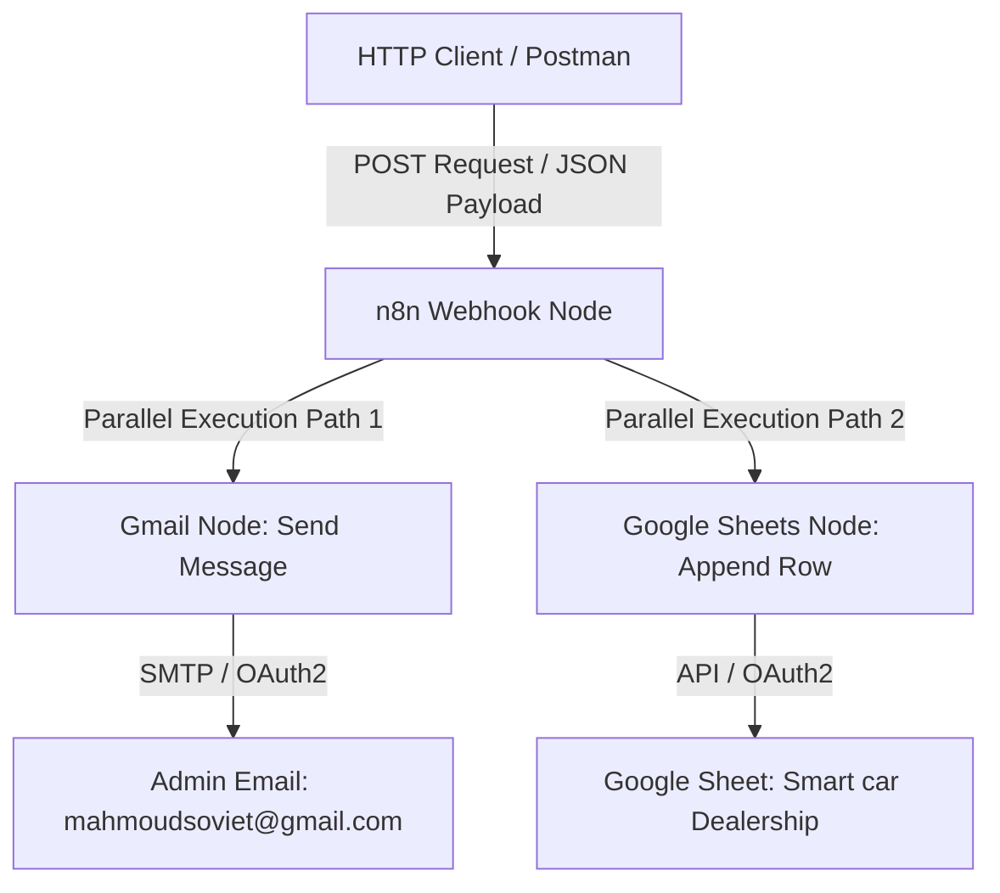

# Complete Project Documentation Package

## 1. Project Overview
* **Project Name:** Automated Sales Notification & Ledger System (Smart Car Dealership Workflow)
* **Project Category:** Business Process Automation / Integration & Event-Driven Workflows
* **Short Professional Description:** An automated event-driven workflow built in n8n that captures sales transaction payloads via an HTTP POST Webhook, logs transaction data into a structured Google Sheet ledger, and dispatches real-time email notifications to administration via Gmail.
* **Main Purpose:** Streamline post-sale data processing by instantly logging purchase details into a central database sheet and notifying stakeholders without manual data entry.
* **Target Users or Businesses:** Automotive dealerships, e-commerce storefronts, sales teams, and small-to-medium enterprises requiring automated transaction logging and alerts.

---

## 2. Problem Statement
Manual logging of sales transactions creates operational bottlenecks, risks data entry errors (e.g., misspelled customer names or incorrect pricing), and delays notification to management or delivery teams. Without automation, sales agents must manually enter transaction details into spreadsheets and send individual notification emails, leading to fragmented communication and potential loss of audit trails.

---

## 3. Proposed Solution
The workflow establishes an HTTP Webhook endpoint that acts as a real-time event listener for POST requests (e.g., triggered via Postman, custom CRM, or point-of-sale systems). Upon payload receipt, n8n executes two parallel branch operations:
1. **Spreadsheet Logging:** Appends the parsed buyer name, car model, and transaction price as a new row in a designated Google Sheet ("Smart car Dealership").
2. **Notification Dispatch:** Formats and sends a plain-text notification email via Gmail OAuth2 to the designated administrative email (`mahmoudsoviet@gmail.com`).

---

## 4. System Architecture

### Architecture Overview
The workflow operates on a standard 1-in-2-out parallel execution architecture:
* **Trigger Component:** `n8n-nodes-base.webhook` (Version 2.1) listening for HTTP POST requests.
* **Destination Component A:** `n8n-nodes-base.gmail` (Version 2.2) executing email dispatch over OAuth2.
* **Destination Component B:** `n8n-nodes-base.googleSheets` (Version 4.7) appending structured data to Google Sheets via OAuth2.

### Mermaid Diagram

