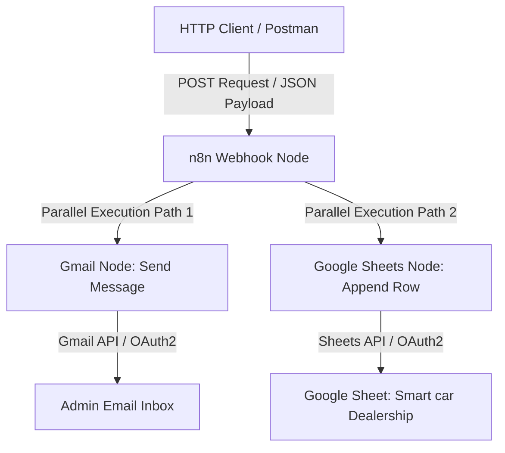

# Smart Car Dealership: Automated Sales Notification & Ledger System

An event-driven **n8n** workflow that captures sales transaction payloads via an HTTP POST webhook, logs them into a structured Google Sheet ledger, and sends real-time email notifications to administration via Gmail.

**Category:** Business Process Automation / Integration & Event-Driven Workflows

---

## Table of Contents

1. [Project Overview](#1-project-overview)
2. [Problem Statement](#2-problem-statement)
3. [Proposed Solution](#3-proposed-solution)
4. [System Architecture](#4-system-architecture)
5. [Technologies & Tools](#5-technologies--tools)
6. [Workflow Execution](#6-workflow-execution)
7. [Core Features](#7-core-features)
8. [AI Implementation](#8-ai-implementation)
9. [Data Flow](#9-data-flow)
10. [Error Handling & Validation](#10-error-handling--validation)
11. [Challenges & Technical Solutions](#11-challenges--technical-solutions)
12. [Business Value](#12-business-value)
13. [Limitations & Future Improvements](#13-limitations--future-improvements)
14. [Technical Project Summary](#14-technical-project-summary)
15. [Setup & Deployment](#15-setup--deployment)

---

## 1. Project Overview

| Item | Details |
|------|---------|
| **Project Name** | Automated Sales Notification & Ledger System (Smart Car Dealership Workflow) |
| **Category** | Business Process Automation / Integration & Event-Driven Workflows |
| **Description** | An automated n8n workflow that captures sales transaction payloads via an HTTP POST Webhook, logs the data into a structured Google Sheet ledger, and dispatches real-time email notifications to administration via Gmail. |
| **Main Purpose** | Streamline post-sale data processing by instantly logging purchase details into a central sheet and notifying stakeholders without manual data entry. |
| **Target Users** | Automotive dealerships, e-commerce storefronts, sales teams, and small-to-medium enterprises needing automated transaction logging and alerts. |

---

## 2. Problem Statement

Manual logging of sales transactions creates operational bottlenecks, risks data entry errors (e.g., misspelled customer names or incorrect pricing), and delays notification to management or delivery teams. Without automation, sales agents must manually enter transaction details into spreadsheets and send individual notification emails, leading to fragmented communication and potential loss of audit trails.

---

## 3. Proposed Solution

The workflow exposes an HTTP Webhook endpoint that acts as a real-time event listener for POST requests (e.g., triggered via Postman, a custom CRM, or a point-of-sale system). Once a payload is received, n8n executes two parallel branches:

1. **Spreadsheet Logging:** Appends the buyer name, car model, and transaction price as a new row in a designated Google Sheet (`Smart car Dealership`).
2. **Notification Dispatch:** Formats and sends a plain-text notification email via Gmail OAuth2 to the designated administrative email address.

---

## 4. System Architecture

### Overview

The workflow uses a standard **1-in-2-out parallel execution** architecture:

- **Trigger:** `n8n-nodes-base.webhook` (v2.1) listening for HTTP POST requests.
- **Destination A:** `n8n-nodes-base.gmail` (v2.2) sending email over OAuth2.
- **Destination B:** `n8n-nodes-base.googleSheets` (v4.7) appending structured data to Google Sheets via OAuth2.

### Architecture Diagram



---

## 5. Technologies & Tools

| Technology | Role in Project | Why Used (Implementation Evidence) |
|------------|-----------------|------------------------------------|
| **n8n** | Workflow orchestration platform | Coordinates event triggering, JSON parsing, parallel branch execution, and credential routing. |
| **HTTP Webhook** | Trigger interface | Receives incoming POST payloads from external clients (e.g., Postman) via endpoint `/<webhook-path>`. |
| **Google Sheets API** | Cloud data sink | Persists structured sales data into spreadsheet ID `<spreadsheet-id>` (`Sheet1`). |
| **Gmail API** | Communication dispatch | Sends automated transaction notification emails using OAuth2 credentials. |
| **JSON Path / Expressions** | Data mapping | Dynamically extracts values from `$json.body` (`car`, `price`, `buyer`) across downstream nodes. |

---

## 6. Workflow Execution

```text
[ POST Request ] ──► ( Webhook Node )
                            │
              ┌─────────────┴─────────────┐
              ▼                           ▼
  ( Gmail: Send Message )     ( Google Sheets: Append Row )
```

### Step 1: Ingestion & Trigger

- **Component:** `n8n-nodes-base.webhook`
- **Operation:** Listens for HTTP POST requests at path `<webhook-path>`.
- **Input:** HTTP request body containing a JSON payload:

  ```json
  {
    "car": "<string>",
    "price": "<string|number>",
    "buyer": "<string>"
  }
  ```

- **Output:** Parsed n8n data structure with the request body under `$json.body`.
- **Necessity:** Entry point for real-time, event-driven triggering from external systems (Postman / CRM).

### Step 2A: Parallel Branch A, Email Dispatch

- **Component:** `n8n-nodes-base.gmail` (Send a message)
- **Operation:** Constructs and transmits a plain-text email.
- **Input:** Dynamic values from `$json.body.car`, `$json.body.price`, and `$json.body.buyer`.
- **Output:** Gmail API response status and sent message details.
- **Email body template:**

  ```text
  A car has been sold and here's the details :
  Car Type : {{ $json.body.car }}
  Price : {{ $json.body.price }}
  buyer : {{ $json.body.buyer }}
  ```

- **Necessity:** Instantly alerts key staff about new sales.

### Step 2B: Parallel Branch B, Ledger Ingestion

- **Component:** `n8n-nodes-base.googleSheets` (Append row in sheet)
- **Operation:** Appends a row to the target document `Smart car Dealership` (`Sheet1`).
- **Column mapping:**

  | Sheet Column | Mapped Expression |
  |--------------|-------------------|
  | `Name` | `={{ $json.body.buyer }}` |
  | `Price ` *(note trailing space)* | `={{ $json.body.price }}` |
  | `Type` | `={{ $json.body.car }}` |

- **Output:** Google Sheets API confirmation object with row append status.
- **Necessity:** Maintains a persistent historical log of all transactions.

---

## 7. Core Features

- **Webhook Processing:** Accepts external HTTP POST inputs with JSON data parsing.
- **Parallel Execution:** Fires email alerts and spreadsheet logging concurrently from a single trigger.
- **Dynamic Expression Binding:** Uses n8n expressions to extract payload variables (`$json.body.*`).
- **OAuth2 Cloud Authentication:** Secures API requests to both Google Sheets and Gmail.
- **Direct Column Mapping:** Explicitly targets the sheet headers (`Name`, `Price `, `Type`).

---

## 8. AI Implementation

**Status:** Not implemented.

This workflow relies purely on deterministic data mapping and API integration. No LLM models, vector stores, or prompt engineering are present in the workflow configuration.

---

## 9. Data Flow

```text
[ Postman / Client ]
        │ HTTP POST Payload
        ▼
[ Webhook Node ] ──► Ingests & constructs $json.body
        │
        ├─────────────────────────────────────────┐
        ▼                                         ▼
[ Gmail Node ]                            [ Google Sheets Node ]
  ├── Extracts:                             ├── Maps:
  │    • $json.body.car                     │    • Name  <-- $json.body.buyer
  │    • $json.body.price                   │    • Price <-- $json.body.price
  │    • $json.body.buyer                   │    • Type  <-- $json.body.car
  ▼                                         ▼
Sends email to admin inbox                Appends new record to "Sheet1"
```

---

## 10. Error Handling & Validation

- **Data Validation:** `attemptToConvertTypes` and `convertFieldsToString` are set to `false` in the Google Sheets node. Type conversion is handled natively by the destination service.
- **Duplicate Detection:** Not implemented. Every incoming valid webhook request is appended without checking existing buyer names or prices.
- **Fallback & Exception Mechanisms:** Standard n8n node failure behavior (the execution stops if credentials fail or required keys are missing). No custom retry nodes or error triggers exist in this version.

---

## 11. Challenges & Technical Solutions

| Challenge | Solution |
|-----------|----------|
| Executing simultaneous actions (email alerts and data persistence) without sequential dependency delays. | Configured n8n's multi-output connection routing from the Webhook node, enabling parallel processing to the Gmail and Google Sheets nodes. |
| Handling whitespace discrepancies in spreadsheet headers (e.g., a column labeled `Price ` with a trailing space). | Defined explicit column mapping rules in the Google Sheets node (`Price ` ← `={{ $json.body.price }}`). |

---

## 12. Business Value

- **Operational Efficiency:** Eliminates manual record creation and messaging, removing manual processing effort per sale.
- **Data Accuracy:** Passes payload variables directly to records, eliminating human typos in financial logs.
- **Real-time Alerting:** Administrative staff receive an instant email upon each sale, enabling rapid post-sale processing.

---

## 13. Limitations & Future Improvements

### Current Limitations

- **Authentication:** The webhook path has no authorization header or token check (open public endpoint).
- **Input Sanitization:** Assumes every incoming JSON body contains `car`, `price`, and `buyer`.
- **Error Catching:** No error branch nodes (Error Trigger / Catch) to handle API outages or missing fields.

### Planned Enhancements

- [ ] **Authentication layer:** Add Header Auth or a secret query parameter check on the Webhook node.
- [ ] **Data guardrails:** Add an `If` or `Switch` node to validate that `buyer`, `price`, and `car` are non-empty before processing.
- [ ] **HTML email templates:** Replace the plain-text body with responsive, branded HTML notifications.
- [ ] **Error alerting:** Add an Error Trigger workflow to send Slack/Telegram alerts if Google Sheets API limits are hit.

---

## 14. Technical Project Summary

An event-driven n8n integration workflow that processes incoming sales payloads via HTTP POST webhooks. The system parses payload parameters (`car`, `price`, `buyer`) and concurrently triggers a dual-destination pipeline: appending transaction details to a cloud Google Sheet while sending an instant notification email through Gmail OAuth2.

---

## 15. Setup & Deployment

### Configuration Requirements

- **n8n Webhook node:** Configured to accept HTTP `POST` requests.
- **Google Sheets OAuth2 credentials:** Requires `googleSheetsOAuth2Api` permissions to append rows to the target sheet.
- **Gmail OAuth2 credentials:** Requires `gmailOAuth2` with scope to send emails.

### Payload Schema Example

Send an HTTP POST request to the Webhook URL with the following JSON body:

```json
{
  "car": "Tesla Model 3",
  "price": "45000",
  "buyer": "John Doe"
}
```

Example with `curl`:

```bash
curl -X POST "https://<your-n8n-host>/webhook/<webhook-path>" \
  -H "Content-Type: application/json" \
  -d '{"car":"Tesla Model 3","price":"45000","buyer":"John Doe"}'
```

### Deployment Steps

1. Import the `workflow.json` file into your n8n instance.
2. Configure the Google Sheets OAuth2 and Gmail OAuth2 credentials.
3. Update the `documentId` in the Google Sheets node to point to your spreadsheet ID.
4. Make sure the sheet has the headers `Name`, `Price ` (with trailing space, or update the mapping), and `Type`.
5. Activate the workflow to listen for live webhook triggers.

### Tech Stack

- **Orchestration:** n8n Workflow Automation Engine
- **Integrations:** Gmail API, Google Sheets API
- **Protocols:** HTTP Webhook, REST, OAuth2
